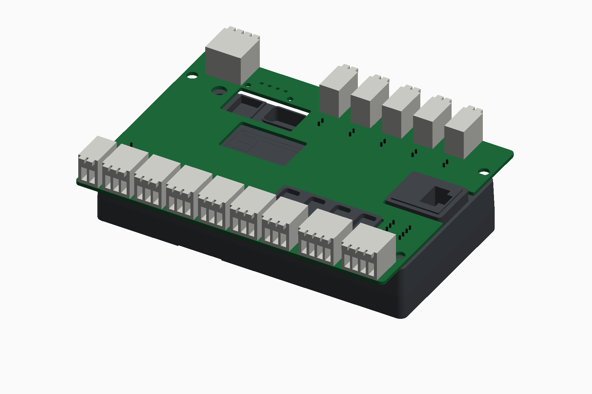
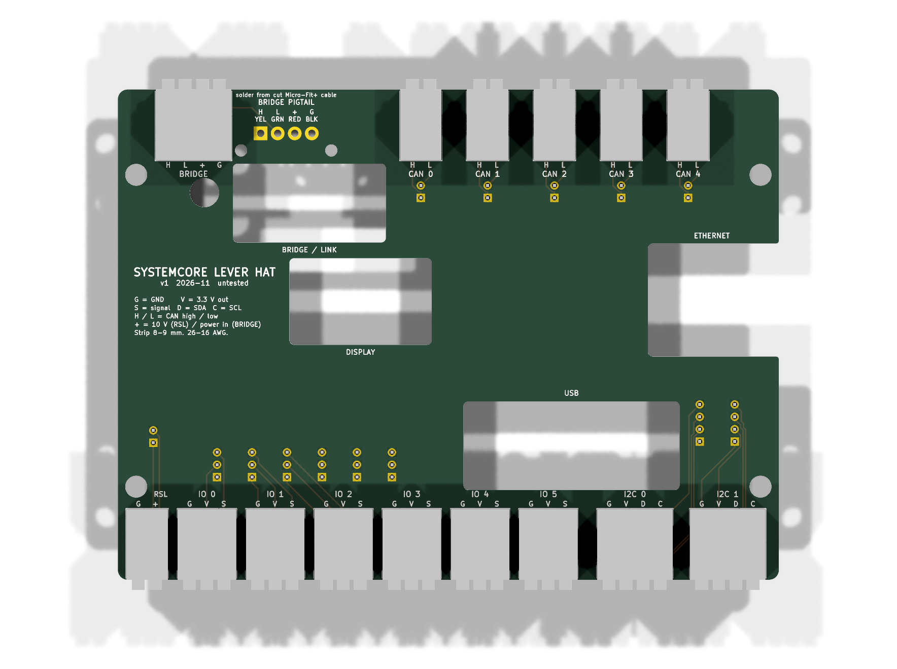
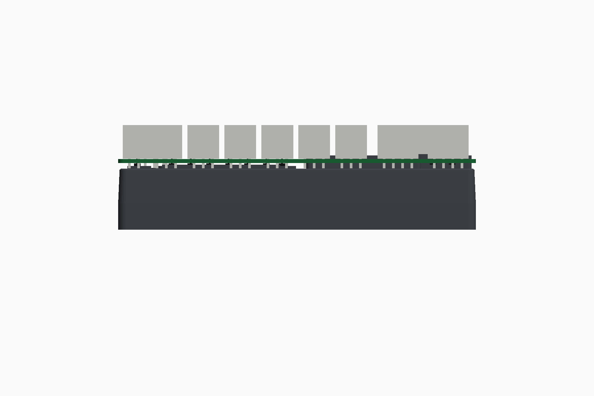

# SystemCore lever hat

A 2-layer PCB that presses onto the top of a Limelight SystemCore and turns every Molex SL port
(5× CAN, 6× SmartIO, 2× I2C, RSL) plus the BRIDGE power/CAN port into WAGO lever terminals, one
lever per wire. Ethernet, the four USB-A ports and the USB-C LINK port stay usable through cut-outs.
Nothing latches: the hat holds by friction on 38 gold contacts, plus the four corner screws if you
run them through it (recommended on a robot).

**Status: designed and checked in CAD only. Not built, not tested.** Read "Check before ordering".



| | |
|---|---|
|  |  |

## How it works

- **Underneath:** 14 single-row 2.54 mm female headers, 11.0 mm tall, gold. SystemCore's SL headers
  (Molex 171971) are shrouded 0.65 mm square pins at 2.54 mm. The socket drops into the shroud's
  3.07 mm wide cavity and bottoms on its floor. That gives 6.1 mm of pin engagement and puts the hat's
  underside 0.5 mm above SystemCore's tallest rim.
- **On top:** WAGO 2601-11xx lever terminal blocks (3.5 mm pitch, 26–16 AWG, wire enters from the
  board edge, lever on top), in two strips that overhang SystemCore's long edges.
- **BRIDGE (Micro-Fit+):** Molex doesn't make a board-mount mate for Micro-Fit+. It also carries
  SystemCore's main power. So it is wired with a short pigtail cut from an official Micro-Fit+ device
  cable: the pigtail plugs into BRIDGE through the window and is soldered to the hat. This one
  connection does latch.
- **Electrically** the hat is a pure 1:1 pass-through. Every lever connects only to its own SystemCore
  pin; no grounds are tied together and there are no components.

## Lever map

Groups are numbered left to right with Ethernet on the right. Check them against the numbers
printed on your SystemCore. Pin order and colours come from Limelight's *FIRST Control System Cable
Specifications* rev 1.

| Hat label | SystemCore port | Levers, left to right as you read the labels |
|---|---|---|
| CAN 0 … CAN 4 | CAN buses (SL 2-pin) | H = CAN high (yellow), L = CAN low (green) |
| BRIDGE | BRIDGE, Micro-Fit+ (via pigtail) | H, L, + = power in, G = ground |
| RSL | RSL (SL 2-pin) | G, + = 10 V switched |
| IO 0 … IO 5 | SmartIO (SL 3-pin) | G = ground, V = 3.3 V out, S = signal |
| I2C 0, I2C 1 | I2C (SL 4-pin) | G, V = 3.3 V, D = SDA, C = SCL |

## Check before ordering

1. **CAN latch side (assumption).** Limelight's simplified STEP draws the five CAN headers as plain
   blocks, so their orientation isn't visible. Every SL header whose orientation *is* visible (SmartIO,
   I2C, RSL) has its latch ramp facing the Ethernet side, and the hat assumes the CAN headers do too.
   Look at your SystemCore. The latch side of an SL header is the wider wall with the slot the cable's
   latch clicks into. If the CAN ones face away from Ethernet, set `CAN_LATCH_SIDE = -1` in
   `gen_hat.py` and regenerate (below). If you don't, CAN H and L land 1.5 mm off and the hat won't seat.
2. **1:1 paper check.** Print `fab/check-print-1to1.pdf` at 100 % (no "fit to page"). The board is
   135.5 mm wide; measure it on the print. Lay it on the SystemCore, outline to outline. Every socket
   pad should sit over a header pin, and the Ethernet, USB, display and BRIDGE/LINK cut-outs should
   line up.
3. **Socket height.** The sockets are hanxia `HX PM2.54-1xNP ZC H11` (LCSC C41427517/18/19), listed as
   11.0 mm. I couldn't get their datasheet. A taller socket is fine: the hat just sits higher, so use
   thicker spacers. A socket under about 10.6 mm makes the hat rest on SystemCore's rims before the
   sockets bottom out, which still gives about 5.7 mm of engagement. Any 2.54 mm female header with an
   11 mm insulator and a 2.5 mm wide body works; use gold (SystemCore's pins are gold).

## Ordering (JLCPCB or PCBWay)

Upload `fab/systemcore-hat-gerbers.zip`.

| Setting | Value |
|---|---|
| Layers | 2 |
| Size | 135.5 × 100.6 mm |
| Thickness | 1.6 mm (the stack height assumes it) |
| Copper | **2 oz recommended** if SystemCore is powered through BRIDGE (1 oz works; see limits) |
| Min track / space / hole | 0.3 / 0.2 / 1.0 mm. No vias. |
| Finish, colour | anything |

All parts are through-hole and easy to hand-solder (about 125 joints). For JLC THT assembly, use
`fab/bom-jlc.csv` and `fab/cpl-jlc.csv` and check every part's rotation in their preview. At the time
of writing JLC had no stock of WAGO 2601-1104, and DigiKey and Mouser stock all three sizes.

### Parts (per hat)

| Qty | Refs | Part | LCSC |
|---|---|---|---|
| 6 | J1–J6 | Female header 1×2, 2.54 mm, 11 mm, gold (hanxia HX PM2.54-1x2P ZC H11) | C41427517 |
| 6 | J7–J12 | Female header 1×3, same series | C41427518 |
| 2 | J13–J14 | Female header 1×4, same series | C41427519 |
| 6 | TB1–TB5, TB7 | WAGO 2601-1102 | C7509568 |
| 6 | TB8–TB13 | WAGO 2601-1103 | C7472698 |
| 3 | TB6, TB14, TB15 | WAGO 2601-1104 | C7472748 |
| ½ | J15 | Official Micro-Fit+ device cable `MFP-R-4_MFP-R-4_DEVICE_300mm`, cut in half (one cable makes two pigtails) | – |
| 4 | – | 2.0 mm spacers or washers for M4/#8, plus screws 2 mm + 1.6 mm longer than your current ones | – |
| 1 | – | Small zip tie (≤ 2.5 mm) | – |

## Assembly

1. **Sockets (underside).** Insert J1–J14 from the bottom (the side with the SystemCore outline) and
   solder on top. Keep them square to the board. Optional, for perfect alignment: put the sockets in
   the hat, press the hat onto an **unpowered** SystemCore, tack one pin per socket, then take it off
   and finish soldering.
2. **Levers (top).** TB1–TB15 go on the top with the wire openings facing out over the board edges.
   Solder underneath.
3. **BRIDGE pigtail.** Cut the device cable in half and strip 3 mm. Push the wires into J15 from the
   top: YEL → H, GRN → L, RED → +, BLK → G. Solder underneath, trim flush, and zip-tie the bundle
   through the two small holes. Leave enough slack to reach BRIDGE through the window.
4. **Continuity.** Check each lever against its SystemCore-side socket contact (42 circuits), and check
   neighbouring levers for shorts.

## Installing

1. Unplug everything from SystemCore's SL ports and BRIDGE.
2. Put a 2.0 mm spacer on each corner screw hole. If your sockets differ, seat the hat first and
   measure the gap.
3. Press the hat straight down. The sockets centre themselves on the pins and stop on the header floors.
4. Plug the pigtail into BRIDGE through the window.
5. Run longer screws through the hat, spacers and SystemCore into the robot.

Wires: strip 8–9 mm, lift the lever, insert, close. 26–16 AWG; FIRST's SL cables are 22 AWG.
Ferrules 0.25–0.75 mm² work.

## Limits and notes

- **Fit is from CAD.** The fit is checked against Limelight's `SYSTEMCORE_SIMPLIFIED_STEP.step`
  (2026-11-19) and Molex drawing 1719710000-SD. `fit_check.py` confirms that only the sockets enter
  SystemCore, that every socket clears its cavity walls by 0.28 mm or more, and that nothing else
  collides.
- **Power through BRIDGE.** Power runs through two lever poles (UL 10 A) and 1.5 mm traces about
  3 cm long. Those traces are good for about 3 A at a 10 °C rise on 1 oz copper, or about 5 A on
  2 oz. SystemCore is rated 40 W max, which is 3.3 A at 12 V and more during brownouts; hence 2 oz.
- **Footprint and height.** The hat is 135.5 × 100.6 mm. It overhangs SystemCore by 13.8 mm on the
  CAN side and 15.4 mm on the SmartIO side. It stands 39.5 mm above SystemCore's base with levers
  closed, and about 48 mm with a lever open.
- **Ports not converted.** USB-A, USB-C LINK and Ethernet are left alone; their data lines can't go
  through lever terminals. The display, status LEDs and the round light pipe stay visible.
- **Rules.** Check the 2027 robot rules for anything about control-system wiring before competing
  with it.

## Regenerating

Everything is scripted. Edit the constants at the top of `gen_hat.py` and rerun:

```sh
/usr/bin/python3 gen_hat.py                                   # KiCad 9's python: board + build/systemcore-hat.dsn
cd build && java -jar freerouting-2.1.0.jar -de systemcore-hat.dsn -do systemcore-hat.ses -mp 40 && cd ..
/usr/bin/python3 -c "import pcbnew; b=pcbnew.LoadBoard('systemcore-hat.kicad_pcb'); \
  pcbnew.ImportSpecctraSES(b,'build/systemcore-hat.ses'); pcbnew.SaveBoard('systemcore-hat.kicad_pcb',b)"
kicad-cli pcb drc systemcore-hat.kicad_pcb                    # expect 0 violations, 0 unconnected
python make_models.py                                         # envelope 3D models (needs cadquery-ocp)
kicad-cli pcb export step --subst-models --user-origin 150x150mm -f -o build/systemcore-hat.step systemcore-hat.kicad_pcb
python fit_check.py SYSTEMCORE_SIMPLIFIED_STEP.step build/systemcore-hat.step --render renders
/usr/bin/python3 make_fab.py                                  # gerbers zip, BOM, CPL, 1:1 print
```

The board coordinates are SystemCore's own, from the STEP: origin at the box centre, +X toward
Ethernet, +Y toward the CAN row. In KiCad they sit at offset (150, 150) with y flipped.
